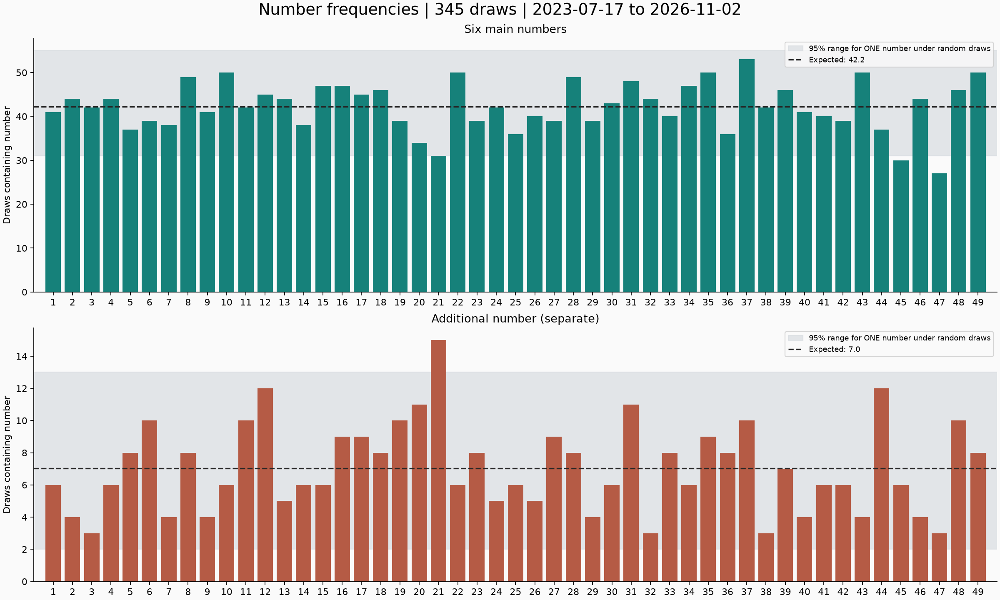
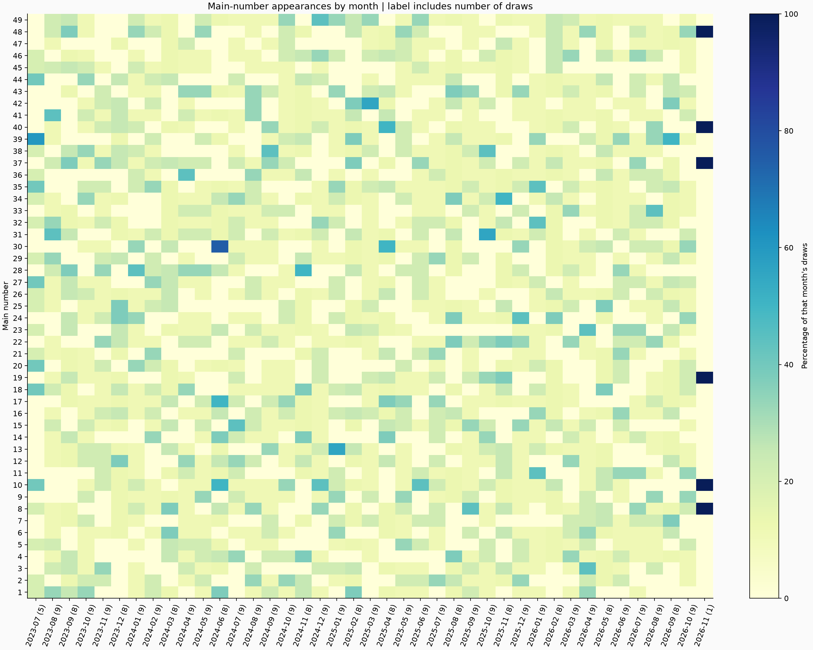
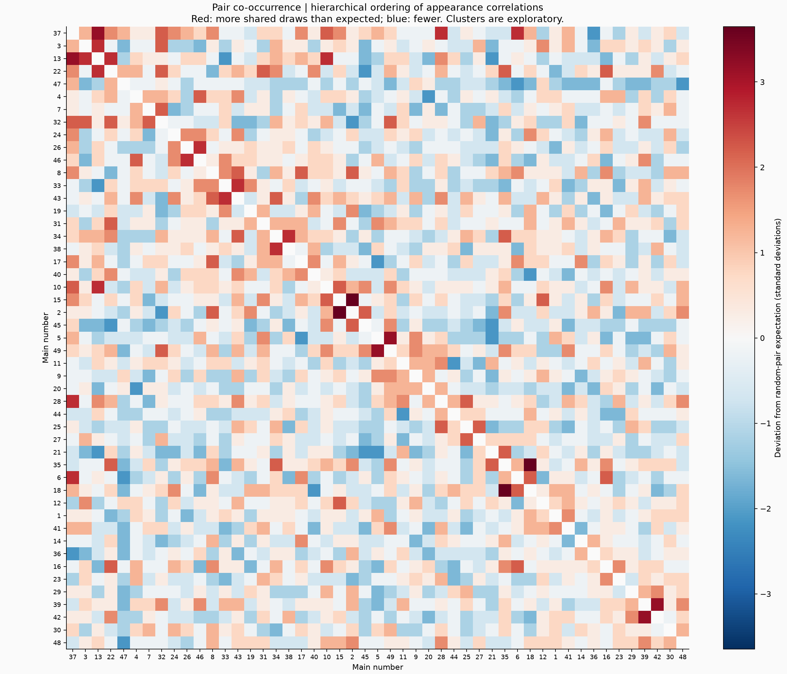
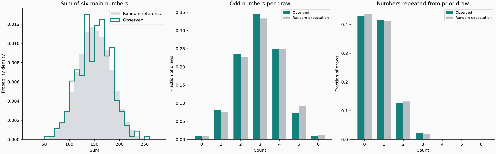

# TOTO Draw Patterns

345 unique draw dates, 2023-07-17 through 2026-11-02. All rows contain six distinct main numbers and a distinct additional number, each in 1-49. Main numbers and additional numbers are analyzed separately. The input CSV is unchanged.

## Findings

- Expected main-number appearances per number: **42.24** (12.24% of draws).
- Most frequent main numbers: **37 (53), 10 (50), 22 (50), 35 (50), 43 (50), 49 (50), 8 (49), 28 (49)**.
- Least frequent main numbers: **47 (27), 45 (30), 21 (31), 20 (34), 25 (36), 36 (36), 5 (37), 44 (37)**.
- Overall frequency test, calibrated against 5,000 simulated independent six-from-49 histories: **p = 0.7900**. The overall main-number frequency variation is not unusual under the random model.
- Most frequent pair: **2, 15**, together in **12** draws; expectation for a preselected pair is **4.40**. Comparing the maximum across all 1,176 pairs gives **p = 0.8848**. This adjustment matters because the pair was chosen after inspecting the data.
- **159 / 345** draws contain consecutive main numbers. Total adjacent pairs: **191**, random expectation **211.22**; two-sided simulation **p = 0.1344**.
- Successive draws share **0.753** main numbers on average; random expectation **0.735**; two-sided simulation **p = 0.6677**.
- Mean main-number sum: **149.58**; random expectation **150**.
- In the latest 50 draws, the leading numbers are **39 (13), 11 (12), 33 (10), 7 (9), 8 (9), 23 (9), 27 (9), 30 (9)**. This window is descriptive, not a forecast.

## Charts

The dashed line is the random expectation. Shading is a 95% range for one preselected number, not a simultaneous limit across all 49; a few bars outside it are expected by chance.

Each column is normalized by its actual draw count, shown in parentheses; partial months have less evidence. Read left to right chronologically.

Hierarchical average-linkage clustering groups numbers with similar binary draw histories (distance = 1 minus Pearson correlation). Cell color compares pair counts with the random expectation. Any dataset, including random draws, produces apparent clusters. Cell colors are not multiple-comparison-adjusted significance tests; the maximum-pair test above handles the search for the strongest pair.

Middle sums, balanced odd/even counts, and occasional repeats or consecutive numbers arise naturally from random sampling. The sum reference is simulated; odd-count and repeat distributions are exact hypergeometric probabilities.

## Limits

Assumes independent, uniformly random six-from-49 draws throughout this period and accurate source data. These are exploratory checks, not a comprehensive randomness certification. Individual p-values across different checks are not jointly adjusted; the maximum-pair test alone accounts for all pairs. Simulation p-values have Monte Carlo uncertainty. No detected pattern establishes a future advantage; under the model, every number still has a 6/49 main-number chance each draw.

## Main-Number Ranking

| Number | Draws | Draw percentage |
| --- | --- | --- |
| 37 | 53 | 15.4% |
| 10 | 50 | 14.5% |
| 22 | 50 | 14.5% |
| 35 | 50 | 14.5% |
| 43 | 50 | 14.5% |
| 49 | 50 | 14.5% |
| 8 | 49 | 14.2% |
| 28 | 49 | 14.2% |
| 31 | 48 | 13.9% |
| 15 | 47 | 13.6% |
| 16 | 47 | 13.6% |
| 34 | 47 | 13.6% |
| 18 | 46 | 13.3% |
| 39 | 46 | 13.3% |
| 48 | 46 | 13.3% |
| 12 | 45 | 13.0% |
| 17 | 45 | 13.0% |
| 2 | 44 | 12.8% |
| 4 | 44 | 12.8% |
| 13 | 44 | 12.8% |
| 32 | 44 | 12.8% |
| 46 | 44 | 12.8% |
| 30 | 43 | 12.5% |
| 3 | 42 | 12.2% |
| 11 | 42 | 12.2% |
| 24 | 42 | 12.2% |
| 38 | 42 | 12.2% |
| 1 | 41 | 11.9% |
| 9 | 41 | 11.9% |
| 40 | 41 | 11.9% |
| 26 | 40 | 11.6% |
| 33 | 40 | 11.6% |
| 41 | 40 | 11.6% |
| 6 | 39 | 11.3% |
| 19 | 39 | 11.3% |
| 23 | 39 | 11.3% |
| 27 | 39 | 11.3% |
| 29 | 39 | 11.3% |
| 42 | 39 | 11.3% |
| 7 | 38 | 11.0% |
| 14 | 38 | 11.0% |
| 5 | 37 | 10.7% |
| 44 | 37 | 10.7% |
| 25 | 36 | 10.4% |
| 36 | 36 | 10.4% |
| 20 | 34 | 9.9% |
| 21 | 31 | 9.0% |
| 45 | 30 | 8.7% |
| 47 | 27 | 7.8% |

## Top Co-Occurring Pairs

| Pair | Shared draws |
| --- | --- |
| 2, 15 | 12 |
| 18, 35 | 12 |
| 5, 49 | 11 |
| 13, 37 | 11 |
| 39, 42 | 11 |
| 3, 13 | 10 |
| 6, 37 | 10 |
| 10, 13 | 10 |
| 13, 22 | 10 |
| 26, 46 | 10 |
| 28, 37 | 10 |
| 33, 43 | 10 |
| 34, 38 | 10 |
| 2, 8 | 9 |
| 2, 45 | 9 |

## Reproduce

Run `python output/toto_patterns/analyze.py` with numpy, matplotlib, and scipy installed. Uses seed 20261103 and 5,000 simulations. Raw summary: [statistics.json](statistics.json).
